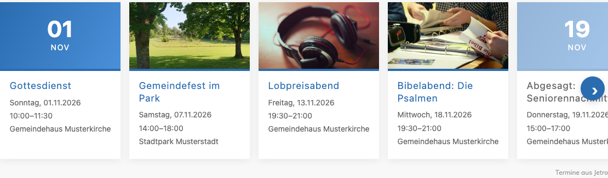
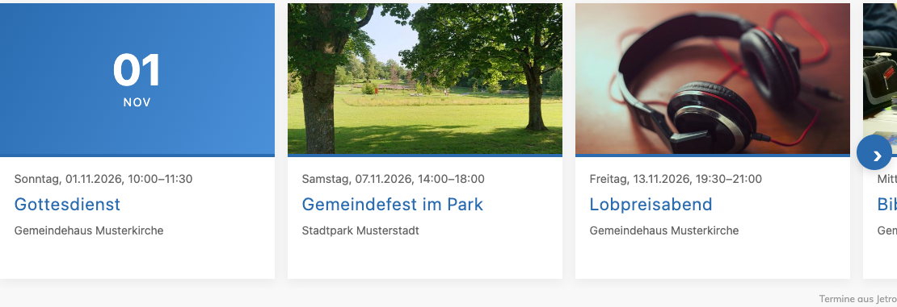
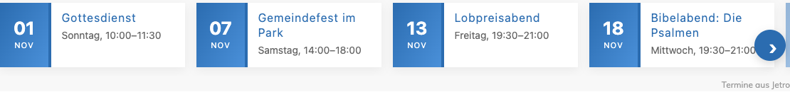
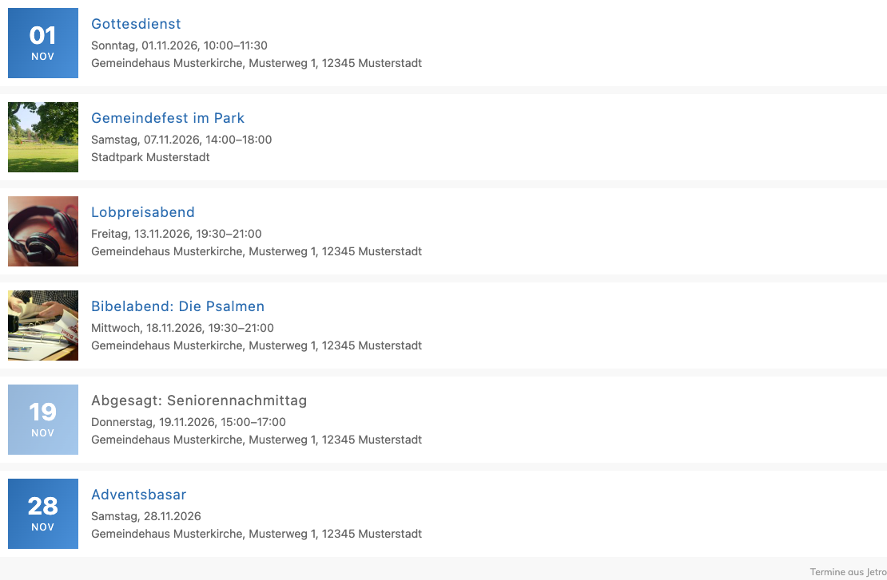

# Jetro für Contao

Übernimmt Termine aus [Jetro](https://jetro.tools) in Contao-Kalender. Jetro schreibt öffentliche Termine
server-zu-server in die Website: anlegen, ändern, absagen, künftige löschen, mit Ort, Bild,
Livestream- und Anmeldelink. Die Redaktion in Contao behält alles, was Jetro nicht liefert
(Veröffentlichung, Hervorheben, Buchungen, weitere Inhaltselemente).

- Contao ab 5.3, PHP ab 8.2
- nur Kern-Felder von `tl_calendar_events`, keine weiteren Erweiterungen nötig
- Lizenz MIT

## Installation

1. Im **Contao Manager** nach „Jetro“ suchen und das Paket installieren, danach die Datenbank aktualisieren.
2. Im Backend unter **Inhalte → Jetro** eine Verbindung anlegen und einen **Standard-Kalender** wählen.
3. In der Liste auf **Token erzeugen** klicken und das Token kopieren. Contao zeigt es nur einmal an.
4. In Jetro unter **Einstellungen → Website** die Betriebsart „Jetro schreibt in Contao“ wählen, die
   Adresse der Website und das Token eintragen und die Verbindung testen.
5. Nach dem ersten Abgleich prüfen, ob die Terminliste der Website den Standard-Kalender zeigt.

Optional: Unter **Kalender-Zuordnungen** einzelne Jetro-Kalender (Schlüssel) eigenen Contao-Kalendern zuweisen.
Umhängen verschiebt die Termine beim nächsten Abgleich.

Token verloren? An derselben Verbindung ein neues erzeugen und in Jetro eintragen. Eine **neue** Verbindung
würde die bisherigen Termine als fremd behandeln.

Die Seite **Protokoll** zeigt die letzten 50 Anfragen von Jetro (Zeit, Pfad, Status, Fehlercode), ohne Inhalte und Token.

## Was das Paket tut

| | |
|---|---|
| Schnittstelle | `<Website>/api/jetro/v1`, nur für Jetro, ohne Session und Cookie |
| Anmeldung | Token je Verbindung, gespeichert nur als SHA-256 |
| Eigentum | Jetro ändert nur Termine, die es selbst angelegt hat |
| Absage | Termin bleibt sichtbar und zeigt „Abgesagt“ in Liste und Leseansicht |
| Löschen | nur künftige Termine; mit Buchungen nur unveröffentlicht; vergangene bleiben als Archiv |
| Bilder | PNG, JPEG, WebP bis 2 MB unter `files/jetro/` |
| Texte | werden wie Backend-Eingaben kodiert, Links nur `http`/`https` |

Hoster, die den Kopf `Authorization` streichen, sind kein Problem: Jetro sendet das Token zusätzlich in `X-Jetro-Token`.

## Entwicklung

```bash
docker build -t jetro-contao-test -f docker/test.Dockerfile docker
docker run --rm -v "$PWD":/app jetro-contao-test sh -c 'composer install && vendor/bin/phpunit'
```

Der Vertrag zwischen Jetro und diesem Paket steht in der Jetro-Spezifikation `website-contao.md`
(Abschnitt „Vertrag Jetro → Paket (api 1)“). Abweichungen nur über eine Änderung dort.

## Termin-Vorlagen (optional)

Das Paket bringt vier Darstellungen für das Modul **Terminliste** aus dem Contao-Kern mit. Alle zeigen das Bild aus
Jetro und ohne Bild ein Kalenderblatt mit Tag und Monat, auch bei Serienterminen. Sie lassen sich mit der Tastatur
bedienen und verzichten bei „Bewegung reduzieren“ auf Animationen. Fremde Skript-Bibliotheken sind nicht nötig.

| Darstellung | Event-Template | Individuelles Template | Empfohlene Bildgröße |
|---|---|---|---|
| Slider mit Karten | `event_jetro_card` | `mod_eventlist_jetro_cards` | 440 × 250, zuschneiden |
| Große Bildkarten | `event_jetro_card_large` | `mod_eventlist_jetro_cards` | 680 × 383, zuschneiden |
| Kompakte Karten (ohne Bild) | `event_jetro_card_compact` | `mod_eventlist_jetro_cards` | – |
| Liste mit Vorschaubild | `event_jetro_list` | `mod_eventlist_jetro_list` | 176 × 176, zuschneiden |






Die Bilder zeigen Musterdaten; Ansichten fürs Handy liegen daneben (`*-mobil.png`).

Einrichtung:

1. Frontend-Modul „Terminliste“ anlegen, Kalender wählen, Format z. B. „Nächste 365 Tage“, Sortierung aufsteigend.
2. **Gesamtzahl der Termine** z. B. 6; **Anzahl der Wiederholungen** größer 0, sonst zeigt Contao jede Serie nur einmal.
3. Event-Template, individuelles Template und Bildgröße aus der Tabelle wählen. Ohne Bildgröße nimmt Contao das Original.

Farben passen sich über CSS-Variablen an das eigene Design an, z. B.:

```css
.jetro-cards,
.jetro-list {
  --jetro-accent: #69bf44;
  --jetro-sheet: linear-gradient(120deg, #36b3a5, #69bf44 60%, #a3cc00);
}
```

Weitere Variablen: `--jetro-sheet-text`, `--jetro-card-bg`, `--jetro-text`, `--jetro-muted`, `--jetro-card-width`,
`--jetro-card-width-large`, `--jetro-card-width-compact`. Abgesagte Termine tragen die Klasse `jetro-cancelled`
und erscheinen ausgegraut mit „Abgesagt:“ vor dem Titel.

Unter jeder Terminliste mit Jetro-Terminen steht klein „Termine aus Jetro“ (Link mit `rel="nofollow"`).
Abschalten lässt sich die Zeile je Verbindung unter **Anzeige**.
